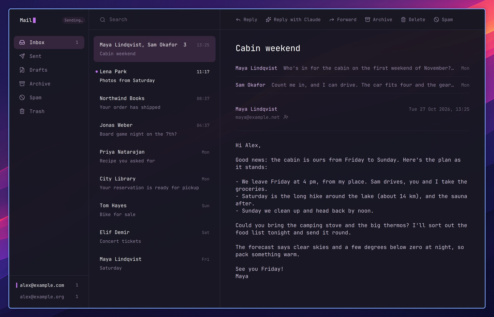
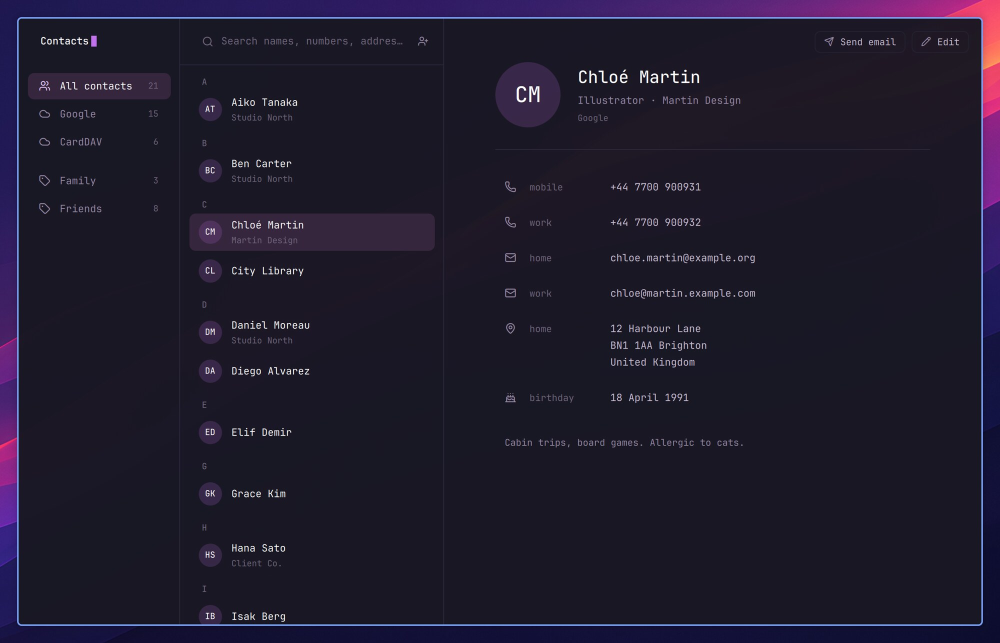
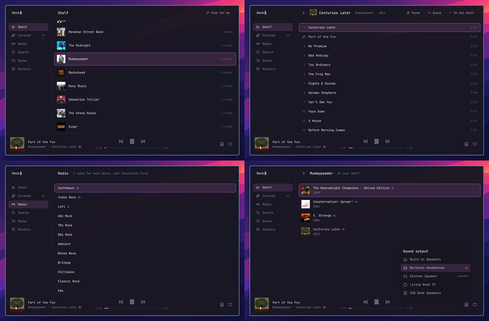
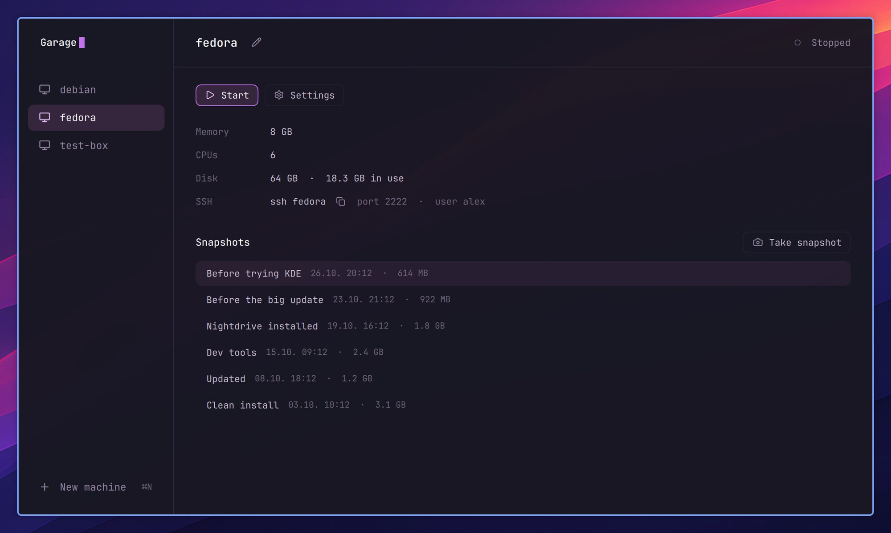
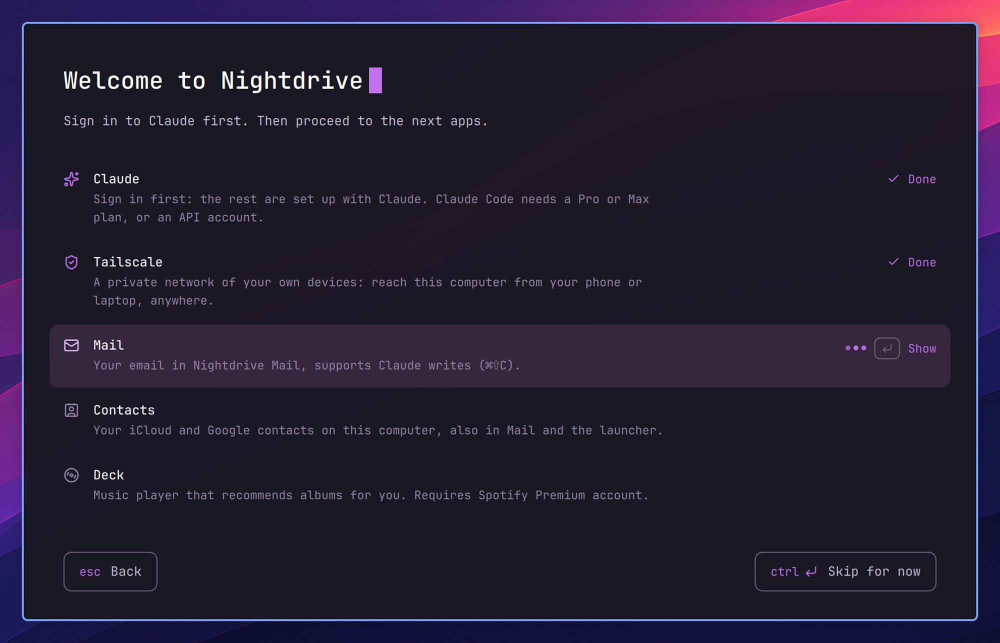

# Changelog

What each release of Nightdrive changed, newest first. `nightdrive update` shows the new ones when it's done, and
each is also the release's page on [GitHub](https://github.com/nightdrive-sh/nightdrive/releases).

## 0.6.1 – 2026-10-28

**A safer Afterglow.** The password prompt works again, and a security audit by [@tommimarkus](https://github.com/tommimarkus), made with [his audit skills](https://github.com/tommimarkus/skills), led to a round of fixes in how Nightdrive installs and updates, and in Mail, LocalSend, AirPlay and Claude's notifications. Thank you, Tommi.

- **The password prompt has its password field back.** In 0.6.0 it was missing, so no system password prompt could be answered (Remote login, installing, system settings) and each one timed out.
- **Installs and updates check what they download:** Ferry comes from a release Nightdrive names, checked by its checksum, and its update no longer runs with your password still cached. Claude Code is installed from Anthropic's signed release instead of a script piped to the shell; RPM Fusion's packages, the fonts and ble.sh are checked too.
- **Mail and Contacts show subjects, senders and contact fields as plain text.** An image hidden in a subject or a name could load in the message list and tell the sender you'd seen the mail. Contacts opens only web and mail links from a card. A sender's name with odd characters in it shows right.
- **LocalSend asks for a code:** when your phone sends, a 6-digit code shows in the middle of the screen and the phone asks for it, so only someone who can see your screen can send to your computer. Sending to your phone asks the first time and then goes only to that phone. `localsend forget` forgets your devices.
- **AirPlay Receiver asks for a PIN** the first time a device mirrors to you; the PIN shows on the screen and the device remembers it until you log in again or the computer sleeps.
- **Claude's permission notification offers Allow only when it shows everything it allows.** A long command, a file edit or an MCP tool now gets Deny and Show session, and you answer in the session.
- **Passwords and tokens stay off the command line,** where other users of the computer could read them: Claude's usage in the top bar, Wi-Fi passwords and the Home Assistant token. Home Assistant's setup warns about a plain http address.
- **Remote login** can no longer be left half on when you cancel the password prompt, which could cut off SSH and close the ports AirPlay, LocalSend and Ferry use. Its switch now waits for your password before it turns.
- **Garage:** a machine shows Booting up and Shutting down, can be paused and resumed (`p`), and starts at its scale without Hyprland's warning.
- **AirPlay speakers** no longer jump loud when they connect: they start at 30 % at most.
- **The Launcher** fits a narrow or low screen, Esc from a page you opened from a search goes back to the search, and Esc closes a Launcher a key opened (⌘⇧V, ⌘⇧E) at once.
- **⌘L** goes to the browser's address bar, and types a path in Files.
- **Notifications show emoji:** Slack's `:thumbsup:` is 👍.
- **Also new:** Send to Claude (⌘⌃C, or Launcher › Tools): the text or files you selected, or a picture on the clipboard, to a Claude Code session's prompt, where you write your question after it. Nothing is sent until you press Enter.
- **After updating:**
  - Restart Firefox: developer settings that had been turned on for everyone go back to their defaults. Your own Firefox settings can go in `config/firefox/user.local.js` (README › Make it yours).
  - The first time your phone sends with LocalSend, or an iPhone mirrors with AirPlay, it asks for the code on your screen.
  - A Garage machine with an older Nightdrive inside: update it there too (`nightdrive update`), or its picture can look stretched.

## 0.6.0 Afterglow – 2026-10-28

**Afterglow.** Claude writes in any app, five apps of Nightdrive's own, Welcome to Nightdrive, and an installer that asks nothing, on Fedora Minimal. The whole story is on [nightdrive.sh](https://nightdrive.sh/news/afterglow/).

- **Claude writes (⌘⇧C):** select a rough draft or a few notes in any app and press ⌘⇧C. Claude writes it out in a tone that fits the place, in your language, and shows it on a card: Enter puts it in place, ⌘⇧C writes another version, Esc cancels. With nothing selected, it asks what to write and puts it at the cursor. In a Claude Code session it writes your prompt, and in a terminal (turn it on in its settings) the command, which runs only when you press Enter. Only what you selected is sent, never from a password manager or a private window, and Claude gets no tools, not even your MCP servers or claude.ai connectors. Settings › Claude writes sets the model and your own instructions.

- **Claude needs a Pro or Max plan.** Claude writes, the reply in Mail, Deck's Curated and the setup in Welcome to Nightdrive work through Claude Code, which needs one. Everything else works without Claude.
- **Mail, Nightdrive's own mail app:** any IMAP account, several at once, your mail kept on your computer, new mail within seconds as a notification you can answer from (Reply, Reply with Claude, Archive, Delete). Made for the keyboard (`?` shows the keys; on a PC the ⌘ keys are Ctrl). Sending goes on in the background, and a message that can't be sent waits in Drafts. ⌘⇧C on a message has Claude write the reply. Remote images stay off, ⇧H opens a newsletter in your browser without loading anything from the network, and only web and mail links open from a message.

- **Contacts, Nightdrive's own contacts app:** your contacts from iCloud, Google or any CardDAV server, kept in sync both ways. Add, edit and delete, with the change on your phone at once; a contact changed on both sides is merged a field at a time. Mail completes addresses from it, and the Launcher finds people by name, company or number.

- **Deck has a window** (Hyper M): your albums on a shelf with their covers, Curated, a radio for each genre, Spotify search, the queue and History, with the player along the bottom and the speaker to play on. Pick for me chooses an album you haven't played in a while. Deck now installs as a package (no more compiling), and Deck 0.1.1 fixes a player that went silent after Pause.

- **Garage, virtual machines in a window** (Hyper G; add it from Launcher › System › Install › Recommended): a new machine from a ready-made Fedora image or an ISO, snapshots to go back to (duplicating one takes no space), `ssh NAME` into a running machine, and the top bar's icon while one runs. Nightdrive in a VM fits itself to the window's size.

- **Any window, any size:** Nightdrive's apps fit the window they're given. Tiled narrower, the sidebar steps aside; narrower still, the list and the message take turns (Enter opens, Esc goes back).

- **Welcome to Nightdrive** opens at your first login on a new install: with Claude, it sets up Tailscale, Mail, Contacts, Deck and Ferry with you, each in a session of its own; without, it shows each one's steps in plain words. Launcher › System › Set up Nightdrive opens it again.

- **Installing:** the installer asks nothing. Claude Code, Tailscale, Mail, Contacts, Deck and Ferry come with every install (`--choose` to pick), Firefox is themed from its first start, and Apostrophe comes along. The recommended base is now Fedora 44 Minimal. An install on Fedora KDE goes on as it is; `nightdrive minimal` turns it into Minimal, Macs too (`--dry-run` first).
- **The Launcher is a calculator:** `3*8`, `15% of 80`, `5 km in miles`, `100 eur in usd`; Enter copies the answer. ⌘⇧V in a Launcher text field pastes from the clipboard history, and System › About Nightdrive shows your version and computer.
- **Keep Awake** (a new plugin): a coffee cup in the top bar keeps the computer awake, lid closed too, until you turn it off or for 1–8 hours.
- **Nightdrive's own system sounds:** volume steps, screenshots, the charger, devices in and out, a wrong password, lock, log out and shut down. Settings › Notifications turns them off.
- **Ferry, one of Nightdrive's apps:** a mailbox between your computers and your phone, now an app of its own in public beta for Linux, the Mac and the iPhone ([TestFlight](https://testflight.apple.com/join/qSG41FTp); another phone uses its page on the Home Screen). It comes with every install, lives in the top bar and takes Nightdrive's colours. Settings forgets a device you no longer use, and codes and passwords leave the box after 15 minutes and stay out of the clipboard history. On another Linux computer: `curl -fsSL https://nightdrive.sh/ferry/install | bash`.
- **Also new:**
  - Dictation on a PC: hold Insert (on a Mac F5 or Fn, as before).
  - The Teams web app opens with Hyper T, like Slack and WhatsApp.
  - Snippets can have several lines (Shift+Enter).
  - Ctrl+click on a file path in the terminal opens it; ⌃⌘+click on a link opens it in a floating window.
  - Firefox starts with an empty window (Settings › Apps › Firefox; History › Restore previous session).
  - The top bar moves icons that don't fit a narrow screen into a … menu, and its logo can be hidden.
  - Files, the file picker and other GTK windows take the theme's background like the terminal.
  - The Claude icon in the top bar has views to pick with a right click.
  - Crash reports can be muted for 15 minutes.
  - `nightdrive ask "…"` opens Claude Code in a new terminal with your message.
  - The documentation is shorter and clearer, with a page of its own for the Mac (what Asahi doesn't do yet) and for trying Nightdrive in a virtual machine on any Mac or PC.
- **Safer:** Mail checks the mail server's certificate when sending; password prompts always come up on top, in the middle; text from windows and crashed programs reaches Claude only as data; the keyring opens even if the first password after installing was mistyped. [The security policy](https://github.com/nightdrive-sh/nightdrive/security/policy) tells how to report a security problem privately.
- **Fixes:** the screensaver no longer stays on after unlocking; the lock screen comes back by itself if it dies (⌃⌥F3 if it doesn't); the startup sound plays again; the desktop opens on workspace 1 without a laptop screen; the network menu works without Wi-Fi and switches wired profiles; Files previews videos; VS Code's Hyper C can be moved; turning crash reports back on works.
- **After updating:**
  - `nightdrive update` installs Mail, Contacts and Ferry once; each stays quiet until you set it up. Removed, they stay removed (Install › Recommended brings them back).
  - **Remote login** now works only over Tailscale and on the networks you allow: the one you're on stays allowed, and each new network asks with a notification. Before, SSH was open on every network.
  - Garage adds `Include config.d/garage` to the top of `~/.ssh/config` the first time it runs.
  - Web apps open other sites' links in your default browser once they're started again.
  - Files takes the new look once it's restarted (`nautilus -q`).
  - Mail can no longer send through an SMTP server with a self-signed certificate.

## 0.5.0 – 2026-10-21

A new look for the top bar's menus, Claude Code sessions in the bar, Theme Editor, and your headphones' microphone.

- **The top bar's menus look like one family:** the same round buttons, section titles and switches everywhere, no
  dividers, and the battery drawn as a battery, also each AirPod's and the case's. ⌘⇧Space and other keys open a menu
  on the screen you're on.

- **Claude menu:** your Claude Code sessions on this desktop, what each is doing, and a click goes to its window. A red
  dot on the bar's icon tells when one finished or needs you while you were elsewhere. Its notifications say which
  session and what it wants, and a permission request can be answered right in the notification (Allow, Deny). After
  updating, open your Claude Code sessions again to get the new notifications.
- **Theme Editor** (Settings › Theme): the window background and how see-through it is, the window borders, the
  shadow and the theme colour, changed live. Save what you made as a theme of your own. It comes with a refined default
  look: no borders on inactive windows, a wide, soft shadow, and a touch more violet in the background.

- **Microphone and camera in use:** their icons appear in the bar while an app records, the microphone's showing the
  level, and a click shows which app it is.

- **Your Bluetooth headphones' microphone:** pick it in the Sound menu, or set Use for › Calls in the Headphones menu.
  Music › best quality switches back, and music started in call mode offers to switch back too.
- **Also new:**
  - Screenshots to the clipboard have a Save button that keeps a copy in Downloads.
  - Settings › Display has the keyboard backlight next to the screen brightness, the Display menu each display's
    scales under its own name, and Night light a switch.
  - Dictation uses the full Parakeet model when you've downloaded it, and stops recording when the key is released
    even after a mouse click.
  - Experimental: when the battery runs low, the open windows are kept, and if it runs out the next login offers to
    open them again.
- **Fixes:** unlocking after sleep no longer flashes the desktop or the lock's error screen; an app's notification
  button removes its row from the history too; EasyEffects no longer crashes when Sony headphones are switched off;
  Thunderbird's calendar reminders float.
- The Hyprland packages come from Nightdrive's new COPR group project; `nightdrive update` switches over by itself.

## 0.4.0 – 2026-10-20

Better with an external display, more terminals to choose from, and a safer headphone jack.

- **An external display works like a second screen should.** Workspaces 1–9 are on the external display and the
  laptop's screen has one of its own (⌘0, a laptop icon in the bar). With the lid closed only the external display is
  used. Settings › Display › Laptop screen sets which side of the display the laptop is on, so the pointer crosses
  where the screens really meet. The bar on the screen without the focus dims its workspace, so you see where the
  keyboard goes.
- **Choose your terminal:** Install › Software › Terminals has Ghostty, Alacritty and foot next to kitty, each with
  Nightdrive's look and keys. Default apps sets which one ⌘Enter opens.
- **Headphone jack:** when something is plugged in, a notification asks whether it's headphones or speakers, and each
  keeps its own volume. Until you answer, the jack plays at most at 25 %, so headphones don't blast at the speakers'
  volume.
- **Low battery warning** at 10 % and 5 %.
- **⌘V pastes a picture in the terminal too**, e.g. a ⌘⇧S screenshot into Claude Code.
- **File pickers, Nautilus and other GTK windows** use the desktop's colours.
- **Crash reports to Claude** (Settings › Notifications, off by default): when a program crashes, a notification
  offers Ask Claude, which opens Claude Code to find out why, or Mute for that program.
- **Locking goes straight to the password prompt.** The logo and sounds are only at boot.
- **Fixes:**
  - Bluetooth: pairing a keyboard shows the passkey it asks for, a long device list scrolls, and device names show
    without stray colour codes.
  - Login screen: the prompt and startup sound are on one screen, and the prompt shows again under the lock.
  - Deck, 1Password and other background apps open centred on the screen you're on, and the drawer opens on the
    right screen.
  - Notifications: buttons with long text wrap, and photos are the right way up.
  - Software search no longer hangs on dnf's key prompt.
  - The screen's rounded top corners start under the bar at every scale.
- **Plugins:** Ferry's menu shows its name at the top, and a long list fades out under the device picker. Ferry shows a
  received image in its notification, and a phone sees a computer wake within seconds. AirPlay Receiver keeps working
  when screens change.

## 0.3.0 – 2026-10-19

- **Ferry sends to the device you pick:** one of your phones or another computer, from the pill in Ferry's menu. Only
  that device gets it. Another computer gets it straight away, and Send Clipboard puts it on that computer's clipboard.
- **Ferry's menu and phone page are new:** what arrived on one card, and Aa (a text), Send Clipboard and + (files) below
  it. Drag files over the menu to drop them on a device. Add Device is in the pill's list.
- **Undo for windows:** ⌘⇧U opens the window you closed with ⌘W again, where it was.
- File pickers open floating in the middle of the screen.

## 0.2.0 – 2026-10-19

The first release tested on a real PC (Intel, NVIDIA RTX, a USB keyboard), with the fixes that came out of it.

- **The lock screen is now the login screen.** Locking (⌃⌘L, after the idle time, before sleep) shows the same screen
  as at boot, with the wallpaper behind it. Before, the lock showed a blurred picture of your windows, which could still
  be read.
- **Waking from sleep works on more machines.** On some PCs the password field took no keys after waking, or the lock
  didn't draw at all. The lock now starts again a moment after waking.
- **Claude Code comes with the install**, so ⌘⌥Enter and the launcher's questions work right away. Run `claude` once
  to log in.
- **Date format in the launcher:** Settings › Top bar › Date format, e.g. 19.10. or 10/19. A system installed in
  English showed 10/19 with no way to change it from the desktop.
- **Fixes:**
  - The display menu in the top bar now changes the scale (it didn't save it).
  - ⌘Enter and ⌘⌥Enter open a terminal again on a new install (the `~/Projects` folder they open in wasn't created).
  - Settings › Battery is gone on a computer without one (it stayed on "Loading…").
  - No more "config has errors" while `nightdrive update` runs, and no Hyprland "updated to …" window after it.
  - Deck uses less CPU while paused on Linux: it closes the sound output until you play again.
- **Dictation on a PC:** docs/dictation.md now covers the PC binaries and giving dictation a key of its own, as a PC
  keyboard has no mic key like the MacBook's F5.

## 0.1.0 – 2026-10-19

Nightdrive's first release. From now on the stable channel gets its changes as releases like this one, each with notes
on what's new.

- A keyboard-driven Hyprland desktop for Fedora, on an Apple Silicon Mac (Fedora Asahi Remix) or a PC: ⌘ shortcuts, one
  launcher for everything, and a top bar of small menus.
- Install it with one line: `curl -fsSL https://nightdrive.sh/install | bash`
- `nightdrive version` shows which release you have, and after an update that brings a new release, its notes are shown
  at the end.
- Optional parts as plugins, such as Ferry (files and the clipboard between your phone and computer), Deck (Spotify),
  LocalSend, AirPlay Receiver and Screen Mirroring.
- The project's new address is github.com/nightdrive-sh/nightdrive. The old links still work.

