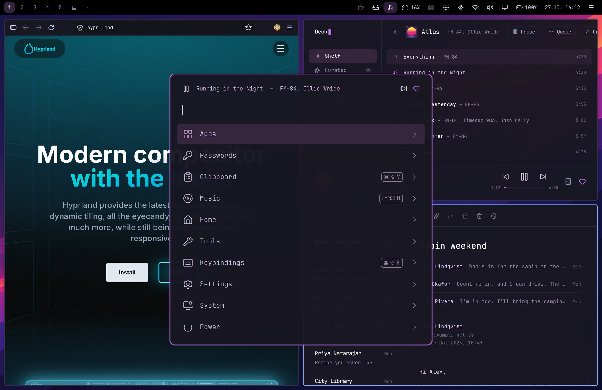
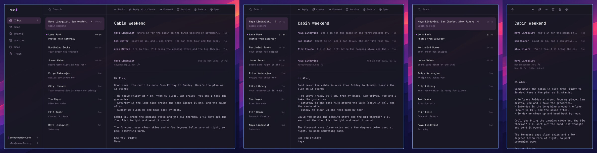
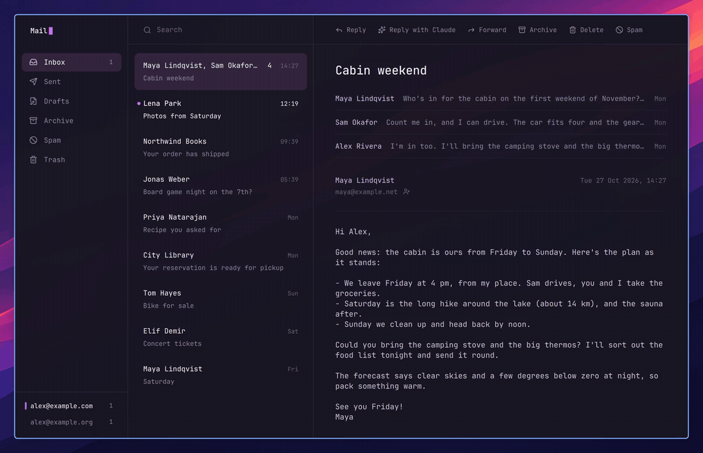

# Nightdrive

**A keyboard-driven Hyprland desktop for Fedora, on a PC or an Apple Silicon Mac (Fedora Asahi Remix).**
⌘ shortcuts that work in every app, one launcher for everything, a top bar of thoughtful little menus, and a synthwave look.



**Hi, I'm [Jari Lehtinen](https://github.com/jarilehtinen).** I've always dreamed of making a desktop of my own. As a web
developer, user interfaces and ease of use are at the core of what I do. So I built a
desktop around what I wanted: windows managed and moved from the keyboard, one launcher for
everything, a top bar that just works, fast and light. With Claude Code, the dream came true, evening by evening.

> **Work in progress.** Nightdrive is my daily setup, published so others can use it or borrow from it. It's made for a PC
> and an Apple Silicon Mac: used every day on a MacBook Pro 14″ (M2 Max), and tested on PCs and in virtual machines.
> Feedback, issues and ideas are very welcome.

## Why Nightdrive?

[Hyprland](https://hypr.land) is a great tiling compositor, but on its own it's a toolkit: no bar, launcher, theme or apps.
Nightdrive puts all of that together into one opinionated desktop.

- **One main key, the Windows key on a PC or Command on a Mac.** This README writes it ⌘ (the Super key).
  ⌘C / ⌘V / ⌘X work in every app, including the terminal. ⌘S saves, ⌘W closes, ⌘Q quits, ⌘Space opens the Launcher.
- **Caps Lock is Hyper, the app key.** Hyper + a letter opens an app or brings it to the front: Hyper B the browser,
  Hyper F Files, Hyper M music. No app uses Hyper itself, so the keys are yours: pick the app for any letter or digit
  in the Launcher (Settings › Apps › App shortcuts).
- **Fits the machine it's on.** The installer recognises a PC, an Apple Silicon Mac or a virtual machine and sets it up to
  match: the keyboard layout you picked when installing Fedora, the graphics driver (NVIDIA too), the display scale. On a
  MacBook the top bar sits in the notch area, the top-row keys control volume, brightness, the keyboard backlight and
  dictation, and sleep is tuned for Asahi.
- **Everything is a keystroke away.** One launcher handles apps, passwords, clipboard history, emoji, screenshots, settings,
  installing packages and power. You rarely need a terminal for everyday things.
- **Apps of its own.** Mail, Contacts, Deck, Garage and Ferry come with it, made for the keyboard and in the desktop's colours.
- **Simple and readable.** Plain config files, a few small scripts, and comments that explain *why*.

## Highlights

### A launcher for everything

**⌘Space** opens the Launcher, as does the N█ logo at the top left of the bar. Start typing, and one search reaches all of it:

- **Apps** and **clipboard history**
- **1Password**: copy a password, username or one-time code
- **Emoji**, **screenshots** and a **colour picker**
- **Settings** and every **keybinding**
- **Software**: install and remove with `dnf`, and updates
- **Power**: lock, sleep, log out, restart and shut down
- **Music**: while it plays, a player row above the list

Type a question and press ⌘⌥Enter to send it to Claude Code. Search "Rename current space" to name the workspace you're
on in the bar.

It counts too: type `3*8`, `15% of 80`, `5 km in miles` or `100 eur in usd`, and the answer is the first row; Enter
copies it. Exchange rates refresh daily, and Settings › Launcher › *Decimal comma in results* answers `3,5`.


### Apps of its own

Mail, Contacts, Deck and Ferry come with every install; Garage waits in Launcher › System › Install › Recommended. They're
made for the keyboard, in the desktop's colours, and fit any window: tiled narrower, the sidebar steps aside; narrower
still, the list and the message take turns.

- **[Mail](plugins/mail/README.md)**: any IMAP account, quiet reading, notifications you can answer from
- **[Contacts](plugins/contacts/README.md)**: iCloud, Google or CardDAV, in sync both ways; Mail and the Launcher find them
- **[Deck](plugins/deck/README.md)**: Spotify (Premium) with your albums on a shelf, in the bar, the Launcher and the media keys
- **[Garage](plugins/garage/README.md)**: virtual machines from a ready-made Fedora or an ISO, with snapshots to go back to
- **[Ferry](plugins/ferry/README.md)**: a mailbox over Tailscale between your computers and your phone



### Claude writes

Select a rough draft or your notes in any app and press ⌘⇧C. Claude writes it out in a tone that fits the place, in the
same language: Enter puts it in place of the selection, ⌘⇧C again writes another version, Esc cancels. With nothing
selected, it asks what to write. In a Claude Code session it writes your prompt; in a terminal (turn it on in its
settings) it writes the command, with a warning if it deletes, overwrites or needs root, and runs it only on Enter.

It needs a Claude Pro or Max plan. Launcher › Settings › Claude writes sets the model and instructions of your own. What
it sends is under [Good to know](#good-to-know).



### Send to Claude

Press ⌘⌃C (or Launcher › Tools › Send to Claude) to send what you're looking at to Claude Code: the selected text, the
files selected in Files, or the picture on the clipboard. The Launcher shows what goes, and Enter puts it at the prompt of the session you pick, or of a new one
(in the files' folder), without sending it: you write your question after it. Instead offers the rest: the clipboard's
text, a screenshot of the window. Text goes as data between tags with the window's title; files and pictures as their
paths, which Claude opens itself.

Nothing is read from the apps Claude writes leaves out (password managers, private windows, your own list in its
settings), a password manager's copy on the clipboard is never read, and clipboard text that looks like a password or
a code stays hidden until you choose it.

### Menus you want to click

Click an icon and a small menu opens under it:

- **Wi-Fi** (and Ethernet with your wired profiles) and **Bluetooth**
- **Display**: brightness, night light, each screen's scale and refresh rate, and mirroring to a TV (Screen Mirroring
  plugin)
- **Battery**: time left and the battery's health
- **System**: load, memory, temperatures and the heaviest processes
- **Date and time**: a month's calendar with week numbers; ‹ › browse the months
- **Tailscale**: your devices, and on or off
- **Sound**: volume and the output, the microphone's volume and which one
- **Headphones**, while Bluetooth headphones are connected: their battery (AirPods per pod and case), an EQ preset made
  for them, noise cancelling, and music or headset mode
- **Microphone** and **Camera**, only while an app uses them: which apps
- **Notifications** (≡ at the right end, or ⌘Esc): the ones you've had, and Do Not Disturb. A click opens the app, a
  right click removes one, Clear removes all.
- **Music**: what Deck is playing, with the cover, the progress and the controls
- **Claude**: your Claude Code sessions and usage limits. A dot on the icon tells a session finished while you were
  elsewhere, and a click goes to its window. A right click changes what the icon shows (5-hour or weekly usage, or the
  number of sessions).

⌘⇧Space walks through the menus with the arrow keys, and ⌘+drag moves an icon. On a narrow screen the icons that don't
fit go into a **…** menu, the ones farthest from the clock first.


### Apps without a terminal, and only the parts you want

**Launcher › System › Install › Software** searches Fedora's packages and Flathub's apps at once, one row per app, with the
details before installing (Tab there takes Flathub's when both have it). Browse has the 100 most popular apps and
categories. System › Remove takes software and web apps away.

Nightdrive's own apps (Mail, Contacts, Deck, Ferry) and Tailscale come with every install; Garage, Nightdrive's app for
virtual machines, waits in System › Install › Recommended. The rest are optional parts, under System › Install:

- **Recommended**: apps Nightdrive sets up for you (1Password, Home Assistant…)
- **Webapp**: ready-made web apps with a key, or any site of your own
- **Plugins**: features for the desktop

A part that isn't installed doesn't show anywhere: no Launcher level, bar icon or key.

### A drawer for what you want at hand

⌘⇧D drops the active window into the drawer, and ⌘D slides the drawer up over your windows, dimming and blurring the rest.
⌘D again puts it away. ⌘⇧D in the drawer sends the window back to the workspace and place it came from. It suits notes,
a to-do list or a chat you want one keystroke away without giving them a workspace of their own.


### Little things that add up

- **Shelf**: drag a file to the top edge of the screen to park it, then drag it into another app.
- **Dictation**: hold F5 or Fn on a Mac, Insert on a PC, speak, and let go. It runs fully offline with Voxtype and Parakeet ([setup](docs/dictation.md)).
- **Snippets**: Launcher › Tools › Snippets; Enter pastes one. With auto-expand on, typing a trigger anywhere replaces it
  with the text. A snippet can have several lines (Shift+Enter), like an email signature.
- **From your phone**: [Ferry](plugins/ferry/README.md), one of Nightdrive's apps, is a mailbox over Tailscale between your
  computers and your phone. Two experimental plugins: [LocalSend](plugins/localsend/README.md) receives files from a
  phone once you accept them, and [AirPlay Receiver](plugins/airplay-receiver/README.md) mirrors an iPhone, iPad or Mac
  into a window.
- **[Screen Mirroring](plugins/mirroring/README.md)**: your screen on an Apple TV or an AirPlay TV, with sound, from the
  display menu or the Launcher (search "airplay"). Google Cast works from Chromium (⋮ › Cast…). Sharing the screen, for
  these and video calls, asks in a themed window: the whole screen or one window.
- **Themes**: seven colours that change the whole desktop at once, two synthwave wallpapers and your own (Settings ›
  Theme). GTK windows such as Files and the file picker follow the colour too.
- **Background apps**: ⌘W only hides chat apps and the music player, so they keep running. Their shortcut brings them straight back.
- **Claude Code waits for you?** Its notification says which session and what it wants, and a permission request can
  be answered right there (Allow, Deny). Allow is offered only when the notification shows all it allows: a long
  command, one run outside the sandbox, a file edit or an MCP tool is answered in its session.
- **Closed by mistake?** ⌘⇧U opens the window you closed with ⌘W again, in the same place. A terminal comes back in the
  same folder, with Claude Code in the same conversation. Press again for the one before it.
- **Battery ran out?** When the battery is low (under 20 % as the laptop goes to sleep, and each minute from 5 %), the open
  windows are kept. If it runs out, the next login asks whether to open them again, each on its workspace.
- **Web apps**: any site as an app window, from Launcher › System › Install › Webapp; System › Remove › Webapps removes
  one, with its logins. Their notifications have the web app's own name and icon (and emoji: Slack's `:thumbsup:` as
  👍), and a link to another site opens in your default browser.
- **Default apps**: which app opens links, mail, folders, text, code, images, video, music, PDFs and calendar files, and
  which terminal ⌘Enter opens: Launcher › Settings › Apps › Default apps (or `nightdrive defaults`). Hyper B, F and E
  open the browser, Files and Email you chose.
- **App shortcuts**: which app Hyper + a letter or digit opens: Launcher › Settings › Apps › App shortcuts. Your choice
  replaces a default, Nightdrive's or a plugin's. The other shortcuts are in the config files ([Make it yours](#make-it-yours)).
- **Mouse**: the wheel's scroll speed, from 0.5× to 3×, in Launcher › Settings › Mouse. The trackpad keeps its own.
- **Remote login**: SSH into this computer from another one, off by default. Turn it on in Launcher › Settings › Remote
  login. It works over Tailscale from anywhere, and on the networks you allow: the one you turn it on at, and each new
  one asks with a notification (safe at home or work, not at a café).
- **Login apps**: what starts at login, in Launcher › Settings › Apps › Startup (or ⌥Enter on an app). Background apps
  start hidden. Only 1Password (if installed) is on by default, as its SSH agent and the Passwords level need it.
- **Login screen**: a password-only login screen in the theme's colours, for the user who installed Nightdrive. It is the
  lock screen too. Another user logs in from the text console (Ctrl+Alt+F3, with Fn on a Mac keyboard). If the lock
  screen ever dies, it comes back by itself, still locked; if it doesn't, ⌃⌥F3 starts it again.

## What's included

| | App | How it fits in |
|---|---|---|
| Window manager | [Hyprland](https://hypr.land) | Lua config, ⌘ keybindings |
| Bar, menus, Launcher | [Quickshell](https://quickshell.org) | one themed shell for the top bar, its menus, the Launcher, the on-screen displays and the shelf; the microphone and camera show in the bar while an app uses them |
| Terminal | [kitty](https://sw.kovidgoyal.net/kitty/) | ⌘Enter, opens in `~/Projects`; ⌘C / ⌘V; Ctrl+click opens a link, or a path in the output (a file in the code editor at its line). Ghostty, foot, Alacritty or WezTerm instead: Settings › Apps › Default apps |
| Browser | Firefox | themed, tabs below the address bar, no tab bar with one tab, starts with an empty window (Launcher › Settings › Apps › Firefox) |
| Mail | [Mail](plugins/mail/README.md) (Nightdrive's own) | quiet reading, notifications you can answer from, replies Claude writes for you to read first |
| Contacts | [Contacts](plugins/contacts/README.md) (Nightdrive's own) | iCloud, Google and CardDAV, in sync both ways; Mail and the Launcher find them too |
| Music | [Deck](plugins/deck/README.md) (Nightdrive's own Spotify player, needs Premium) | bar icon, music menu, player row in the Launcher, media keys |
| Phone | [Ferry](plugins/ferry/README.md) (Nightdrive's own) | a mailbox both ways with your phone and other computers, over Tailscale |
| Virtual machines (optional) | [Garage](plugins/garage/README.md) (Nightdrive's own, qemu and KVM) | Hyper G; ready-made Fedora VMs or an ISO, snapshots to go back to |
| Passwords (optional) | [1Password](plugins/1password/README.md) and its `op` CLI | Passwords level in the Launcher, SSH agent |
| AI | [Claude Code](https://claude.com/claude-code) (log in once with `claude`) | ⌘⌥Enter, ask from the Launcher, Claude writes (⌘⇧C), sessions and usage limits in the bar |
| Dictation | [Voxtype](https://github.com/peteonrails/voxtype) (Parakeet, offline) | hold F5 or Fn (Mac), Insert (PC) to talk |
| Network | NetworkManager, BlueZ, [Tailscale](plugins/tailscale/README.md) | Wi-Fi, Bluetooth and Tailscale menus |
| Audio | PipeWire, [EasyEffects](https://github.com/wwmm/easyeffects) | output switching (AirPlay speakers too, starting at most at 30 %), EQ presets for headphones, AirPods battery and settings, the headphone jack asks what went in |
| Notifications | Quickshell | the app's icon and buttons, history and Do Not Disturb in the bar, a low battery warning; a crashed app's notification can Ask Claude why |
| Sounds | Nightdrive's own, made from scratch | notification sounds to choose from, and the desktop's own (volume, screenshot, charger, devices, lock); Launcher › Settings › Notifications turns them off |
| Files and images | Nautilus, Loupe | |
| Markdown | [Apostrophe](https://apps.gnome.org/Apostrophe/) | `.md` files open in it, themed |
| Web apps | Chromium app windows | your own, or ready-made ones with a key: WhatsApp, Slack, Teams, YouTube |
| External display | Hyprland | workspaces 1–9 on the display, one on the laptop's screen (⌘0); with the lid closed only the display is used; where the laptop's screen is in Launcher › Settings › Display |
| Lock and idle | the login screen as the lock, hypridle | a screensaver after 10 min (a synthwave sunset, a falling-characters rain or a big clock), lock after 30 min (Settings › Screensaver) |
| Smart home (optional) | [Home Assistant](plugins/home-assistant/README.md) | rooms, devices and scenes in the Launcher, pinned devices in the bar |
| Mail, alternative (optional) | Thunderbird | themed, with a minimal toolbar ([details](docs/thunderbird.md)) |
| [Mac Keyboard Shortcuts](plugins/keyd/README.md) (optional) | [keyd](https://github.com/rvaiya/keyd) | ⌥⌫ deletes a word, ⌘⌫ to the line start; in Files Enter renames, ⌘O opens |

The optional parts, and more (LocalSend, AirPlay Receiver, Screen Mirroring, VS Code, Jottacloud…), are in Launcher ›
System › Install or `nightdrive plugins`.

## Requirements

One of these, with a minimal Fedora 44: Nightdrive adds what the desktop needs, nothing else. The installer tells which
machine it's on and sets it up to match.

- A **PC** (x86_64) with **Fedora 44** from the [Everything netinstall image](https://fedoraproject.org/misc/), with
  *Fedora Custom Operating System* picked in its Software Selection, and NVIDIA, AMD or Intel graphics. See
  [docs/pc.md](docs/pc.md) for the install and what's different on a PC.
- An **Apple Silicon Mac** (M1 or M2 series) with **[Fedora Asahi Remix](https://asahilinux.org/fedora/) 44**, its
  **Minimal** image (one of the choices in the Asahi installer). See [docs/mac.md](docs/mac.md) for the install and
  what's different on a Mac.
- A Fedora 44 **virtual machine** on the computer you already have, Mac or PC ([docs/vm.md](docs/vm.md)).

The KDE edition of either (Fedora Asahi Remix with KDE Plasma, Fedora 44 KDE) works too: KDE stays as a fallback session
until `nightdrive minimal` removes it ([Install](#install)).

Claude's features (Claude writes, Ask Claude, Mail's Reply with Claude, Deck's Curated, setting things up with Claude in
Welcome to Nightdrive) need a paid Claude plan, Pro or Max. The rest of Nightdrive works without one.

## Install

On a fresh Fedora 44 (above), logged in as your user on its text console, with a network connection:

```sh
nmcli device wifi connect "Network name" --ask   # on Wi-Fi; a cable needs nothing
curl -fsSL https://nightdrive.sh/install | bash
```

That runs [`bootstrap.sh`](bootstrap.sh): it installs git, clones Nightdrive into `~/dotfiles` and starts its installer.
`bash -s -- --dev` clones the dev channel instead; the [installer options](#installer-options) go after `--` too. The
same by hand:

```sh
sudo dnf install -y git   # a fresh Fedora has no git
git clone https://github.com/nightdrive-sh/nightdrive.git ~/dotfiles
cd ~/dotfiles
./install.sh
```

It tells which machine it's on and then runs unattended: sudo asks for the password once at the start, and the system
update takes a while. On a Mac it first asks for the keyboard layout, if it's still the Minimal image's `us`, as the
login screen's password is typed with it (`--keyboard "fi mac"` answers in advance).

A minimal Fedora gets what a desktop edition would have: it boots to the login screen, the firewall lets LocalSend and
AirPlay in as on Fedora KDE, and SSH stays off until you turn on Remote login (Launcher › Settings), unless you install
over ssh.

Claude Code, Tailscale, Mail, Contacts, Deck and Ferry come with every install and stay quiet until you set them up. The
optional parts that are on by default (Apostrophe, YouTube) come too; the rest can be added later from the Launcher
(System › Install) or with `nightdrive plugins install ID` (`nightdrive apps install garage` for an app).

**Trying it on the system you already use?** Nightdrive doesn't remove your apps: on a Mac only the services listed
under [Installer options](#installer-options) go (`--choose` unticks them). Your configs in `~/.config` are moved aside to
`<name>.bak-<time>`, and `switch.sh off` (below) brings back KDE's login screen.

Then **reboot**.

If the login screen can't start (Hyprland can't, say for a missing graphics driver), a text login comes up in its place:
log in, and `start-hyprland` starts the desktop or shows why it can't. Ctrl+Alt+F3 gives one too. `config/greeter/switch.sh`
picks the login screen:

| `switch.sh` | Login screen |
|---|---|
| `autologin` | Nightdrive's, the desktop behind it (the default) |
| `on` | Nightdrive's, starting the desktop after the password |
| `text` | A text login that starts the desktop after the password (`!bash` at its prompt for a text console), until the graphics are fixed |
| `off` | On Fedora KDE, KDE's (KDE stays installed as a fallback); on Fedora Minimal, which has none, the text login |

### Installer options

Give them to `./install.sh`, or after `--` in the curl line (`bash -s -- --choose`).

| Option | What it changes |
|---|---|
| `--no-greeter` | No Nightdrive login screen. On Fedora KDE, keeps KDE's; pick **Hyprland** there (not *Hyprland (uwsm-managed)*). On Fedora Minimal, which has none, a text login (greetd's agreety) that starts the desktop after the password |
| `--no-autologin` | The Nightdrive login screen starts the desktop after the password, instead of being its lock (black flashes at boot) |
| `--no-splash` | Keeps Fedora's boot splash and the GRUB menu (`config/splash/install.sh off` later) |
| `--choose` | Lists the optional parts (and on a Mac the removals) first, to tick or untick |
| `--keyboard "fi mac"` | The keyboard layout and variant for the login screen, the desktop and the text console, without asking (xkb names: `localectl list-x11-keymap-layouts`) |
| `--vm` | The virtual machine settings, if the VM isn't detected as one ([docs/vm.md](docs/vm.md)) |
| `--no-nvidia` | On a PC, leaves an NVIDIA card's driver alone instead of installing RPM Fusion's ([docs/pc.md](docs/pc.md)) |
| `--with 1password,slack` | These optional parts on top of the defaults (`--dry-run` lists the ids) |
| `--without youtube` | The defaults without these; combines with `--with`, and leaves out Tailscale, Mail, Contacts, Deck or Ferry too |
| `--all` / `--none` / `--defaults` | Every optional part / none / the defaults (Apostrophe, YouTube); Tailscale, Mail, Contacts, Deck and Ferry come with each |
| `--dry-run` | Shows the optional parts, the packages and system settings it would add and what it would remove, then stops |

To pick the optional parts yourself, run `./install.sh --choose`: it lists them first (a number toggles one, Enter
continues):

```
Machine: Apple Silicon Mac (Fedora Asahi Remix, keyboard: fi mac)

  Nightdrive apps
   1 [x] Contacts          Your iCloud and Google contacts in a window of their own, kept in sync
   2 [x] Deck              Spotify player (needs Premium), Launcher and top bar
   3 [x] Ferry             Files and text both ways with your phone over Tailscale, no app
   4 [ ] Garage            Virtual machines: start, snapshot and restore them
   5 [x] Mail              Mail over notmuch: quiet reading, notifications, Claude's replies

  Recommended apps
   6 [ ] 1Password         Password manager: Launcher › Passwords, op CLI, SSH agent
   7 [x] Apostrophe        Markdown editor (Flatpak), opens .md files
   …

  Web apps
  13 [ ] Slack             Slack as a web app (Hyper+S)
   …

  Plugins
  17 [ ] AirPlay Receiver  Mirror an iPhone, iPad or Mac here (UxPlay, experimental)
   …

  22 [ ] Install all       every optional part above

  23 [x] Remove services   28 installed packages a Mac doesn't use: realmd sssd-common sssd-kcm nfs-utils …
```

The last row is a Mac's only: the Minimal image's server services (network logins and shares, system logs, crash
reports) and other Wi-Fi chips' firmware, listed in `packages-remove-asahi.txt`.

### First login

At your first login, **Welcome to Nightdrive** opens and asks whether you have Claude Code (a Pro or Max plan).

- **With Claude**, sign in there first. Then Claude sets up Tailscale, Mail, Contacts, Deck and Ferry with you, each in
  a session of its own that does only that one thing.
- **Without**, it shows each one's steps right there, one at a time in plain words.
- **I'll do it myself** lists the apps, each opening its README in Apostrophe.

Leave what you don't need. Launcher › System › *Set up Nightdrive* (or `nightdrive welcome`) opens it again, and later
logins remind you with a notification until you finish it or say not to.

A few things stay manual:
- 1Password: in Settings › Developer, turn on *SSH agent* and *Integrate with 1Password CLI*. The Launcher's Passwords level
  needs the CLI integration.
- Thunderbird, if you chose it: open it once, then run `./link.sh` again to give it Nightdrive's theme (its profile
  doesn't exist before the first start).
- Optionally, set up dictation ([docs/dictation.md](docs/dictation.md)).

`./link.sh` on its own just (re)links the config files and is safe to run again. The repo can live anywhere; `~/dotfiles` is
only a convention.

### From Fedora KDE to Minimal

An install on Fedora KDE goes on as it is, with KDE as a fallback session. `nightdrive minimal` makes it what a fresh
install on Minimal is. Run it with `--dry-run` first: it lists what would go (KDE and what only it needed, some 600
packages) and what stays as yours, and changes nothing. Then, from Nightdrive's desktop or a text console (not Plasma):

```sh
nightdrive minimal   # asks once; --keep kate,okular keeps KDE apps you still use
```

It switches to Nightdrive's login screen, takes a read-only btrfs snapshot of the root and lets dnf remove what nothing
you keep needs. The kernel, the boot loader and what the system needs to start or repair itself always stay: if dnf would
remove one of them, it stops first. KDE's settings move to `~/.local/share/nightdrive/kde-config-<time>`, and Wi-Fi
networks whose password was in KDE's wallet ask for it again.

The way back is printed at the end and kept in `~/.local/state/nightdrive/minimal-undo.txt`: `sudo dnf history rollback`
while the repos still have KDE's versions, or the snapshot in the root's place. Once you're happy with Minimal, delete
the snapshot (the same file says how), as it holds on to KDE's files.

### Updating

Nightdrive checks for new changes every six hours and shows a notification with an **Update** button when there are some.
You can also update any time from the Launcher (**Update**) or a terminal:

```sh
nightdrive update
```

An install without one of Nightdrive's apps (Mail, Contacts, Deck, Ferry) gets it with the next update, once. Remove
one, and it stays removed: Launcher › System › Install › Recommended or `nightdrive apps install mail` brings it back.
Settings › Apps › Nightdrive apps turns one off or on.

It never overwrites your own edits: a repo with uncommitted changes is skipped with a note. On an install older than the
command, run it once as `~/dotfiles/bin/nightdrive update` (a plain `git pull` misses the new links and packages).

Updates come from **Stable** (the `main` branch), released once tested. **Development** (`dev`) gets every change
first: Launcher › Settings › Update channel, or `nightdrive channel dev` (`nightdrive channel stable` goes back).

Stable gets the changes as releases, each with notes on what's new: an update that brings one shows its notes at the end,
`nightdrive version` tells which release you have, and every release is in the [changelog](CHANGELOG.md). The Launcher's
**System › About Nightdrive** (or search "version") shows the release, the channel and the computer, with links to the
website, the documentation and the GitHub issues.

#### The nightdrive command

The same `nightdrive` command reaches the settings from a terminal (`nightdrive` alone lists everything):

| Command | What it does |
|---|---|
| `nightdrive update` | Updates Nightdrive and the system (above) |
| `nightdrive update check` | Only looks for new changes (what the six-hourly check runs) |
| `nightdrive channel` | The update channel, stable or dev; `nightdrive channel dev` switches to it |
| `nightdrive version` | The release you have, and the channel |
| `nightdrive minimal --dry-run` | On an install on Fedora KDE: what turning it into Fedora Minimal would remove, and what stays as yours; without `--dry-run` it does it ([Install](#install)) |
| `nightdrive theme color teal` | Theme colour: violet, blue, teal, green, amber, rose or graphite; aerc (if you use it) gets it too, unless you have picked a styleset of your own |
| `nightdrive theme set background '#181722'` | The look: the terminals', the Launcher's, Firefox's and Thunderbird's background and opacity, the window borders and shadows; `nightdrive theme look` lists the settings, `default` puts one back (also Theme Editor, Launcher › Settings › Theme) |
| `nightdrive theme save "My theme"` | Saves the colour and the look as a theme of your own; `nightdrive theme themes` lists them, `use ID` switches, `delete ID` removes one, `reset` goes back to Default |
| `nightdrive wallpaper set <image>` | Changes the wallpaper; `nightdrive wallpaper current` prints it |
| `nightdrive display list` | Each screen's even scales; `nightdrive display scale eDP-1 2` sets one |
| `nightdrive bar-style opacity 80` | Top bar opacity; also `icons`, `icon-opacity` and `highlight` |
| `nightdrive topbar adjust` | Top bar icon and text sizes, half a pixel at a time, live |
| `nightdrive topbar date dmy` | The clock's date: `dmy` 19.10., `mdy` 10/19, `iso` 10-19 or `auto` (the system language's order); also Launcher › Settings › Top bar › Date format |
| `nightdrive apps` | Nightdrive's own apps (Mail, Contacts, Deck, Ferry, Garage) and whether each is installed; `nightdrive apps install garage` installs one, `off` and `on` as for plugins |
| `nightdrive plugins` | Optional parts and whether each is installed and on; `nightdrive plugins install home-assistant` runs one's installer |
| `nightdrive plugins off ferry` | Hides an installed part from the desktop and stops its services, for one that misbehaves (`on` brings it back; also the switch on its page in the Launcher) |
| `nightdrive plugins add <git-url>` | Adds a plugin from someone else's repo, marked external in the Launcher; `nightdrive update` keeps it up to date, `nightdrive plugins remove ID` deletes it |
| `nightdrive ask "Fix the clock"` | Opens Claude Code in a new terminal with that as its first message, as ⌘⌥Enter does from the Launcher; `--dir DIR`, `--name NAME`, `--effort LEVEL`, `--background` (without taking the keyboard) and `--workspace WS` |
| `nightdrive welcome` | Opens Welcome to Nightdrive: setting up Tailscale, Mail, Contacts, Deck, Ferry… with Claude (signed in first), each on its own, by hand a step at a time, or from their READMEs (Launcher › System › *Set up Nightdrive*) |

## Keys

⌘ is the Super key: the Windows key on a PC, Command on a Mac. Hyper is Caps Lock: Hyper + a letter opens an app, and
which app is yours to choose (Launcher › Settings › Apps › App shortcuts).

| Keys | Action |
|---|---|
| ⌘ Space | Launcher |
| ⌘ Enter | Terminal |
| ⌘ ⌥ Enter | Claude Code (with text typed in the Launcher: sends it as the prompt) |
| ⌘ C / ⌘ V / ⌘ X | Copy, paste, cut, in every app |
| ⌘ S | Save |
| ⌘ W | Close (background apps are only hidden) |
| ⌘ Q | Quit |
| ⌘ ⇧ U | Open the closed window again |
| ⌘ ⇧ F | Fullscreen |
| ⌘ ⇧ T | Tile or float the window |
| ⌘ ⇧ J | Split direction (⌘ ⇧ arrows move the window) |
| ⌥ Tab / ⌥ ⇧ Tab | The app's next / previous window |
| ⌘ 1…0 | Go to a workspace |
| ⌘ ⇧ 1…0 | Move the window there |
| ⌘ D | Drawer: show or hide |
| ⌘ ⇧ D | Put the window in the drawer, or take it back out |
| ⌘ ⇧ V | Clipboard history |
| ⌘ ⇧ E | Emoji |
| ⌘ ⇧ C | Claude writes, in any app ([Claude writes](#claude-writes)) |
| ⌘ ⌃ C | Send the selection, files or a picture to a Claude Code session ([Send to Claude](#send-to-claude)) |
| ⌘ ⇧ S | Screenshot of a region, to the clipboard (Save in the notification keeps a copy) |
| ⌘ ⌥ S / ⌘ ⌥ ⇧ S | Screenshot of a window / of the screen |
| Hyper B / F / E / M / P | Browser / Files / Email / Music / 1Password |
| ⌘ ⇧ Space | Walk through the top bar menus with the keyboard |
| ⌘ Esc | Notifications |
| F5 / Fn / Insert | Dictation, held: F5 or Fn on a Mac, Insert on a PC ([another key](docs/dictation.md)) |
| ⌘ ⇧ K | All shortcuts (also in the Launcher under *Keybindings*) |

The full list is in [`config/hypr/SHORTCUTS.md`](config/hypr/SHORTCUTS.md).

## Make it yours

- **Machine settings.** The installer writes the machine's own into `config/hypr/local.lua`: the display scale and the
  keyboard layout, which the login screen uses too. A scale or refresh rate picked in Launcher › Settings › Display wins
  over it. The defaults at the top of [`config/hypr/hyprland.lua`](config/hypr/hyprland.lua) are a MacBook's (scale 2,
  Finnish Mac keyboard).
- **X11 apps** (REAPER, Steam, Discord) draw at the screen's full resolution, so they are sharp but small on a scaled
  screen: turn up the app's own scale or zoom in its settings.
- **Per-machine overrides** go to `config/hypr/local.lua`, which git ignores.
- **Keybindings** are in [`config/hypr/bindings.lua`](config/hypr/bindings.lua), a plugin's in its own folder. Apps
  open with Hyper (Caps Lock, `MOD3`) + a letter, chosen in the Launcher (Settings › Apps › App shortcuts); a Hyper key
  bound in `local.lua` (`hl.bind("MOD3 + D", …)`) is a default that a choice there replaces.
- **Optional parts** (recommended apps, ready-made web apps, plugins): a one-line part, such as a web app or an app from
  dnf or Flathub, is a line in [`plugins.txt`](plugins.txt), with its keybinding in `bindings.lua`'s `optional` list and
  SHORTCUTS.md (with an `{id}` tag). A part with files of its own (a top bar module and menu, keys, a service, commands)
  is a folder in [`plugins/`](plugins), like [`plugins/ferry`](plugins/ferry). [`plugins/README.md`](plugins/README.md)
  explains how to make one, with a small example to copy. A plugin of your own can live in its own repo, with the
  folder's files at its top: `nightdrive plugins add <git-url>` clones it.
- **Background apps**: apps that ⌘W should only hide are in
  [`config/hypr/background-apps`](config/hypr/background-apps).
- **Reopened terminals**: the programs that ⌘⇧U starts again in a closed terminal (editors and the like) are in
  [`config/hypr/reopen-commands`](config/hypr/reopen-commands).
- **Launcher apps**: only the apps in [`config/fuzzel/apps-allow.txt`](config/fuzzel/apps-allow.txt) are listed. Search finds
  the rest.
- **Private additions**: some things don't belong in a public repo, like work tools or a personal dashboard. You can keep them in
  your own private repo and link them into git-ignored *local* slots. Nightdrive loads them when they exist:

  | Slot | What you can add there |
  |---|---|
  | `config/hypr/local.d/*.lua` | autostart entries, window rules, keybindings |
  | `config/hypr/background-apps.local`, `reopen-commands.local`, `SHORTCUTS.local.md` | more background apps, more programs ⌘⇧U starts again, your own entries in the shortcut list |
  | `config/quickshell/local/` | `<Name>Menu.qml` bar menus, and `LauncherExtension.qml` for your own Launcher levels |
  | `config/fuzzel/apps-allow.local.txt` | more apps shown in the Launcher |
  | `config/kitty/local.conf`, `config/ghostty/local.ghostty`, `config/alacritty/local.toml`, `config/foot/local.ini` | your own kitty, Ghostty, Alacritty and foot settings (font, size, keys), over Nightdrive's |
  | `config/firefox/user.local.js` | your own Firefox prefs (`user_pref(…)`, e.g. the Browser Toolbox), after Nightdrive's; written into the profile by `nightdrive update` |
  | `config/topbar/local.modules.jsonc`, `status.local`, `local.adjust.conf` | your own bar modules (at the left end of the icons), their status and icon sizes |

## How it fits together

- **Quickshell** draws the top bar and its menus. The modules are listed in `config/topbar/modules.jsonc`. Each one gets its
  state from `config/topbar/scripts/status <name>` (an icon name, a text and a class), and a click opens `<Name>Menu.qml`
  under it. Icons are SVGs: Lucide by name, or `pack:name` from any [Iconify](https://icon-sets.iconify.design) set (fetched
  once). Sizes are in `config/topbar/adjust.conf`.
  Quickshell reloads when one of its files is saved, and a short popup says so ("The top bar reloaded", "restarted", or
  "didn't reload" with the error), so it doesn't go unnoticed.
- The menus use ordinary command-line tools such as `wpctl`, `nmcli`, `bluetoothctl`, `upower`, `tailscale`, `cliphist` and `dnf`.
  There are no daemons of their own.
- The theme script (`config/hypr/scripts/theme`) derives every shade from one colour. It writes a small file for Quickshell,
  fuzzel, hyprlock and GTK (`config/gtk-*/gtk.css` imports it), then reloads them.
- Deck writes its playing state to a small JSON file. The bar, the music menu and the Launcher read that file.

## Good to know

- **Known issues** that have a workaround but no fix in Nightdrive yet are listed in [docs/known-issues.md](docs/known-issues.md),
  each with its own issue labelled `known issue`.
- **Hyprland comes from Nightdrive's own COPR.** Fedora's own repositories have no Hyprland, so on every machine the
  installer takes the Hyprland packages from [`@nightdrive/nightdrive`](https://copr.fedorainfracloud.org/coprs/g/nightdrive/nightdrive/)
  (aarch64 and x86_64; specs in [nightdrive-packages](https://github.com/nightdrive-sh/nightdrive-packages)) and limits
  that repository to them. Ghostty comes from there too.
- **The Claude menu** reads your plan's limits with Claude Code's own sign-in, so Claude Code must have been run once.
- **Claude writes (⌘⇧C)** sends the selected text (or what you type in its card), and the window's class and title, to
  Anthropic through Claude Code, and only when you press the key. Claude has no tools there, not even your MCP servers
  or claude.ai connectors, and nothing is saved as a session. Its text goes in only after you've seen it, the clipboard
  gets its own content back, and the text isn't kept in the clipboard history.
- **No credentials are stored in this repo.** Tokens stay with each app (Deck, Claude Code) or in 1Password.

## Want to participate?

Nightdrive is work in progress, and help of almost any kind moves it forward:

- **Try it on your machine.** It's used daily on a MacBook Pro 14″ (M2 Max) and tested on a PC and in virtual machines.
  A report from your PC (NVIDIA, AMD or Intel graphics) or Apple Silicon Mac is valuable (in Discussions), whether
  everything worked or something broke.
- **Ask or share in [Discussions](https://github.com/nightdrive-sh/nightdrive/discussions):** questions, ideas, how it runs
  on your machine, or a screenshot of your setup.
- **Open an [issue](https://github.com/nightdrive-sh/nightdrive/issues)** for a bug or a rough edge. A screenshot or the output
  of the failing command helps a lot.
- **Send a pull request.** Keep it small and in the spirit of the rest: plain files, comments that explain *why*, and nothing
  personal (that goes in the git-ignored local slots, see [Make it yours](#make-it-yours)). [`AGENTS.md`](AGENTS.md) has the
  working notes, handy for people and coding agents alike. Not running Nightdrive yourself? `nightdrive sandbox` runs the
  desktop in a headless container on Linux with Podman and a GPU, for checks and screenshots ([docs/sandbox.md](docs/sandbox.md)).
- **Wallpaper artists welcome.** There's only so much time, and wallpapers are where I'd most love a hand. The ones in Nightdrive
  were made with ChatGPT image generation for now, and I'd much rather ship art by real artists. If you make synthwave
  art, or know someone who does, and would like to see it on Nightdrive desktops, say hello in
  [Discussions](https://github.com/nightdrive-sh/nightdrive/discussions).

## Credits

Inspired by [Omarchy](https://omarchy.org). Built on [Hyprland](https://hypr.land) and [Quickshell](https://quickshell.org), on top of the [Asahi Linux](https://asahilinux.org) team's work. The colours start
from the [Tokyo Night](https://github.com/enkia/tokyo-night-vscode-theme) palette, and the icons are [Lucide](https://lucide.dev) (ISC).
The wallpapers were made with ChatGPT image generation for now (artists welcome, see [Want to participate?](#want-to-participate)).
The Tailscale logo in the bar is Tailscale's trademark.

## License

[MIT](LICENSE). The bundled Lucide icon font and icons are ISC-licensed.
