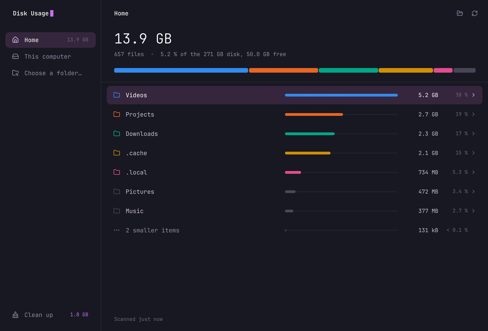

# Disk Usage

What takes up the space on your disk, folder by folder, biggest first: a bar shows how the folder on show splits, and a click takes you into the part that matters. Clean up empties what is safe to: the Trash, thumbnails, and the caches apps make again by themselves.

## Using it

| Keys | |
| --- | --- |
| `?` | Disk Usage's keys |
| ↑ ↓ or `j` `k` | Move in the list |
| `Enter` → or `l` | Open the folder (on a file: show it in Files) |
| ← `h` ⌫ or `Esc` | Up a folder |
| `o` | Show in Files |
| `c` or ⌘C | Copy the path |
| `Delete` | Move to the Trash, after asking |
| `1`–`9` or Ctrl+↑ Ctrl+↓ | A place in the sidebar |
| ⌘O | Choose a folder |
| ⌘R | Scan again |
| ⌘⇧⌫ | Clean up |
| ⌘B | Hide or show the sidebar |

- The sidebar has your home folder, the system disk (This computer), mounted disks and the folders you chose. Each place opens on its last scan at once; ⌘R scans it again.
- Sizes are the space on the disk, as `du` counts it: a file with hard links counts once, and another disk mounted inside a folder is left out. On the system disk, folders that aren't yours can't be read and are left out too (the line at the foot counts them).
- The five biggest entries have a colour of their own, in the bar and the list; the rest share a grey one. The smallest entries of a big place are folded into one row, *N smaller items*, and opening a folder made mostly of them looks closer at it.
- Move to the Trash frees the space only once the Trash is emptied: Clean up does it.
- Clean up lists what it can empty, with the size of each, ticked: the Trash (on every disk), thumbnails, browsers' caches (theirs in Flatpak too), downloaded packages (pip, uv, npm, Yarn, Cargo, Go) and shader caches. Untick what you want to keep, then `Enter`. It never touches anything else in `~/.cache`, where some apps keep what isn't a cache (offline music, Python environments).

## In a terminal

| Command | What it does |
| --- | --- |
| `disk-usage` | Opens Disk Usage, or brings it forward |
| `disk-usage FOLDER` | Opens it on FOLDER |
| `disk-usage top [FOLDER] [N]` | The N biggest entries of FOLDER (your home folder, 20) |
| `disk-usage clean` | What Clean up can free, a line each |
| `disk-usage clean ID…` | Empties these (`clean` names them), or `all` |
| `disk-usage cleanup` | Opens Clean up in the window |
| `disk-usage install`, `uninstall` | Disk Usage among your apps, or out of them |
| `disk-usage restart`, `quit`, `log` | After a change to Disk Usage, and its QML errors |

Needs: Python 3
