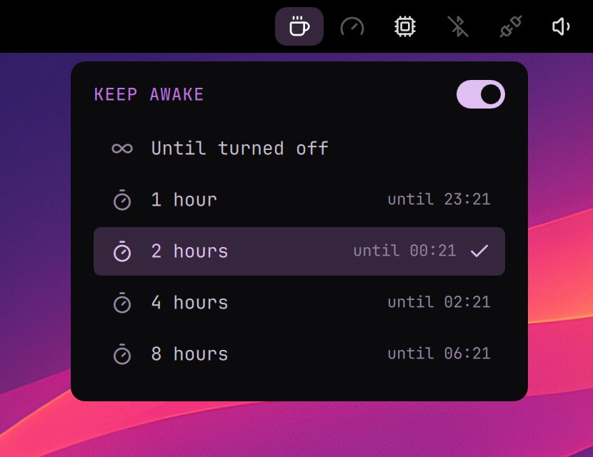

# Keep Awake

Keeps the computer awake while you need it: watching, presenting, a long download. No screensaver, lock, screen-off or sleep, for a few hours or until you turn it off.

- The coffee cup in the top bar is lit while Keep Awake is on. A click opens its menu: until turned off, or 1, 2, 4 or 8 hours. A right click turns it on or off.
- In the Launcher: Tools › Keep Awake (or type awake or caffeine).
- Closing the lid doesn't put the computer to sleep either, but choosing sleep yourself still works. Logging out turns it off.

## In a terminal

| Command | What it does |
| --- | --- |
| `keep-awake on` | Keep awake until turned off |
| `keep-awake on 90` | Keep awake for 90 minutes |
| `keep-awake off` | Back to the usual idle times |
| `keep-awake status` | Whether it's on, and until when |

It's a systemd inhibitor: `systemd-inhibit --list` shows it as Keep Awake.

Needs: nothing to install (systemd-inhibit comes with systemd)
