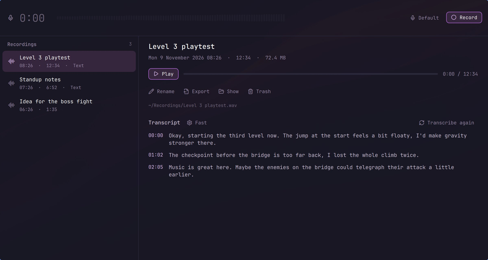

# Recorder

Record from a microphone into `~/Recordings`: pause and go on as often as you like, and the pieces are saved as one WAV (48 kHz mono). The recording goes on with the window closed. Each one can be transcribed into text beside it, offline with Voxtype.

## The window

Hyper R opens it: the recordings, newest first, under the microphone's level and Record. While it records, the window is a low strip (the time, the level, the microphone, Pause, Save, New) and grows back once saved; `l` shows the recordings meanwhile.

| Key | What it does |
| --- | --- |
| Space | Record, pause, go on |
| ⏎ | Save; not recording, open the picked recording |
| `n` | New: save, and start the next one at once |
| `m` | The microphone to record from (remembered; not in the middle of a piece: pause first) |
| `p`, ← → | Play or pause the picked recording; back or on five seconds |
| F2 | Rename it, with its transcript and exports |
| `e` | Export it beside the WAV: MP3 (128 kbps), M4A (AAC), FLAC or Opus |
| `o` | Show it in Files |
| `t` | Transcribe it, or stop transcribing (the transcript before it stays) |
| ⌘, | Settings (also the model's name over the transcript): the folder, the transcription model and Whisper's language, transcribing when saved |
| ⌘⌫ | To the trash; ⌘Z puts it back (and undoes a rename) |
| `?` | Every key |

A Bluetooth headset (AirPods and the like) is in the microphone list even while it only plays: recording from it switches it to its headset mode, where music sounds poorer, until the recording is saved.

## Transcripts

A saved recording is transcribed at once (Settings › Transcribe when saved) into `NAME.txt` beside it: a paragraph for
each minute or so, cut where you paused, each with its time (`[01:30]`); a click on the time plays it from there. It
runs in the background with the window closed, one recording at a time, and goes through your own corrections as
dictation does (Dictation › Your own corrections).

| Model | |
| --- | --- |
| Fast (default) | Parakeet int8 (`voxtype-onnx`): an hour in a few minutes; it finds the language itself |
| Medium | Whisper medium (`voxtype`): nearly as exact, in about two thirds of the recording's length |
| More exact | Whisper large-v3-turbo (`voxtype`): about as long as the recording takes (M2 Max CPU); Finnish, English or Auto |

All three are Voxtype's, installed by hand as for Dictation (the docs); Settings says what is missing. Whisper's
models: `voxtype setup --download --model medium` (or `large-v3-turbo`).

While a recording is made or paused, the top bar shows a microphone and the time: a click pauses or goes on, a right click saves, a middle click opens the window.

## With Claude

In Settings › Claude › Access, the Recorder row lets Claude list your recordings and read their transcripts (on the Normal level it asks each time, as for notes), and transcribe one or rename it, with Undo in the notification. Claude doesn't record, play or delete.

## In a terminal

| Command | What it does |
| --- | --- |
| `recorder record` | Start recording, from the default microphone (`--mic NODE`: a PipeWire source by its node name; `--name NAME`), or go on after a pause |
| `recorder pause` | Pause |
| `recorder toggle` | Record, pause or go on: one key for all three |
| `recorder save` | End the recording and save it as `NAME.wav` (`--name NAME`); a new recording is named by its day and time |
| `recorder new` | Save, and start the next recording at once |
| `recorder status` | What is being recorded and for how long |
| `recorder list`, `recorder info NAME` | The recordings, newest first; one recording |
| `recorder transcript NAME` | Its transcript's text |
| `recorder rename NAME NEW` | A new name for the recording, its transcript and exports |
| `recorder trash NAME` | The recording and its files to the trash, where Files puts them back |
| `recorder export NAME FORMAT` | A copy beside it as `mp3`, `m4a`, `flac` or `opus`; made again if there is one |
| `recorder show NAME` | The recording in Files |
| `recorder transcribe NAME` | Transcribe it in the background (`--wait`: here, with its progress; `--cancel NAME`: stop it) |
| `recorder transcriptions` | Those under way, and those that failed |
| `recorder models` | The transcription models, and what each still needs |
| `recorder headsets` | The Bluetooth headsets to record from: `--mic` takes their card (`bluez_card.…`) |
| `recorder config [KEY VALUE]` | The settings: `folder`, `mic` (a node name, empty for the default), `model`, `language`, `transcribe_on_save` |

Each takes `--json`. A saved name is never overwritten: the new one is `NAME (2)`. If a recording is cut off (a crash, a power cut), the next `recorder` command saves what it had as `NAME (recovered)`. `RECORDINGS_DIR` points the commands at another folder.

Needs: nothing to set up (PipeWire's `pw-record` and `pactl`, and ffmpeg, which Nightdrive has); for transcripts, Voxtype as for Dictation
Keys: Hyper R
