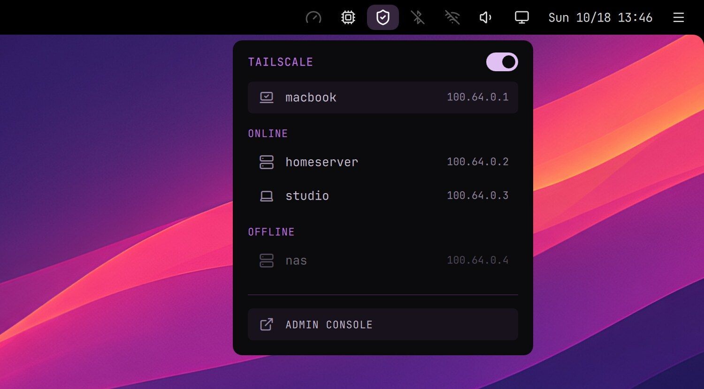

# Tailscale

A private network between your own devices: reach your home server, NAS or Home Assistant from anywhere, as if you were at home.



- The icon in the top bar shows whether you're connected, and a right click turns Tailscale on or off.
- Its menu lists your devices: a click on a computer opens a terminal with `ssh` to it (by its Tailscale name, with your own user name or the `User` in `~/.ssh/config`), and the copy button beside it copies its address. Phones, tablets and offline devices copy on a click. On a shared tailnet, other people's devices wait under their owner's name; a click there copies too. Launcher › Settings › Tailscale has the same.

## Setting up

Log in once after installing: Welcome to Nightdrive (Launcher › System › *Set up Nightdrive*) walks you through it, with Claude or without. Or pick *Log in* in the top bar menu. The installer makes you Tailscale's operator, so no password is needed. If the switch says *Permission denied*, run once:

```
sudo tailscale set --operator=$USER
```

Homepage: https://tailscale.com
Needs: a Tailscale account (free for personal use)
